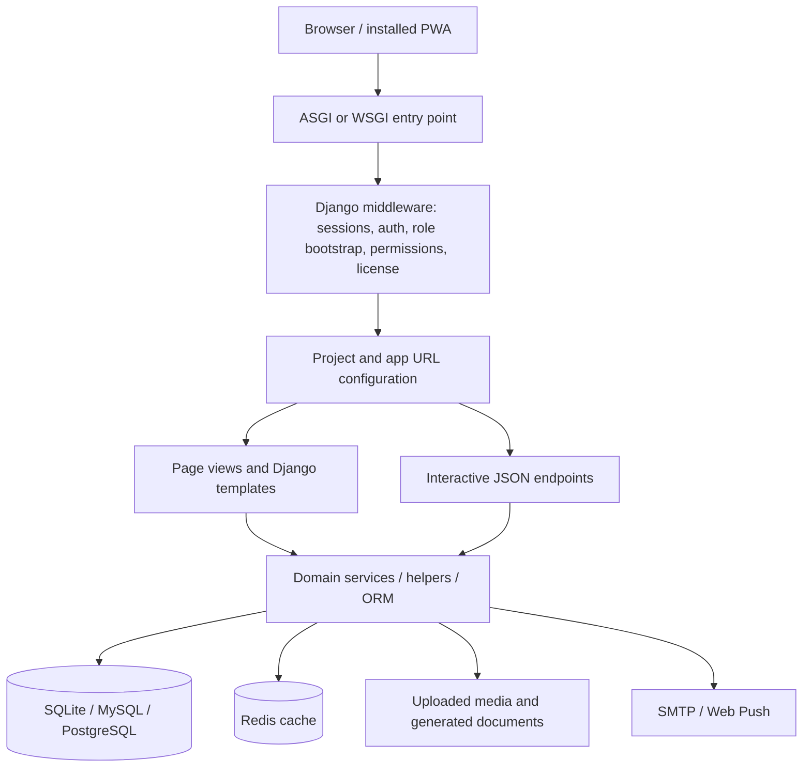

# Architecture

Baseline: 2026-11-17. This is a source-based map. Follow referenced modules for exact fields and behavior; do not infer that every existing endpoint satisfies the conventions in RULES.md.

## System shape

A single Django project hosts eleven local apps. Django auth, sessions, templates, ORM, middleware, and management commands provide the main runtime. Role-specific pages share one UI shell. Business APIs are ordinary Django views rather than a separate declared REST-framework service. Finance APIs are split into domain modules while preserving management-facing URLs.

ASGI serves collected static assets directly. Local upload requests pass through Django session authentication in both ASGI and WSGI.

## Repository layers

| Layer | Location | Responsibility |
| --- | --- | --- |
| Project composition | `schoolStackPro/` | Settings, root URLs, ASGI/WSGI, dotenv loading |
| Shared identity and school context | `homeApp/` | Owners, schools, sessions, authentication, licensing, branding, audit |
| Academic and staff management | `managementApp/` | Academic records, permission maps, dashboards, reports, session rollover |
| Finance domain | `financeApp/models.py`, `financeApp/services.py`, `financeApp/api/` | Financial state, posting/business rules, management-facing API handlers |
| Role portals | `teacherApp/`, `studentApp/` | Role-specific views/APIs/templates and portal helpers |
| Operational domains | `libraryApp/`, `transportApp/`, `hostelApp/`, `inventoryApp/` | Operational models and workflows linked to school/session |
| Documents and communication | `certificateApp/`, `chatApp/` | Certificate lifecycle and chat lifecycle |
| Cross-cutting helpers | `utils/` | Response envelopes, decorators, validators, school lookup, caching, images, logs |
| Static assets | `static/` | Shared scripts, styles/assets, PWA worker and icons |
| Automation | `.github/workflows/` | Validation and SSH deployment |

## Request lifecycle

1. Settings initialization loads the repository-root `.env`; settings choose database and integrations.
2. Security, WhiteNoise, gzip, and request-performance middleware wrap requests.
3. Session/common/conditional-response middleware and audit context are installed before CSRF/authentication.
4. Authentication makes the Django user available; role-session bootstrap initializes role context.
5. Management permission middleware resolves action access; license middleware applies school license restrictions.
6. URL resolution dispatches to a page, API, or document/communication route.
7. View decorators and scoped queries enforce the relevant user, school, session, and record access.
8. Services perform nontrivial mutations, ideally within an atomic transaction, and responses return HTML or the expected JSON contract.

Middleware ordering is significant. Read `homeApp/middleware.py`, `homeApp/audit.py`, and `schoolStackPro/settings.py` before moving layers. Audit context uses thread-local state and is cleared in middleware cleanup; async/concurrency changes require targeted review.

## Route ownership

| Public prefix | Modules / namespace |
| --- | --- |
| `/admin/` | Django admin |
| `/`, `/api/` | `homeApp`, `homeAppAPI`; root also includes PWA URLs |
| `/management/`, `/management/api/` | `managementApp`, `managementAppAPI` |
| `/management/api/cached/` | `managementAppCachedAPI` |
| `/management/library/`, `/management/library/api/` | `libraryApp`, `libraryAppAPI` |
| `/teacher/`, `/teacher/api/` | `teacherApp`, `teacherAppAPI` |
| `/student/`, `/student/api/` | `studentApp`, `studentAppAPI` |
| `/certificates/`, `/certificates/api/` | `certificateApp`, `certificateAppAPI` |
| `/chat/` | `chatApp` |
| `/transport/`, `/transport/api/` | `transportApp`, `transportAppAPI` |
| `/hostel/`, `/hostel/api/` | `hostelApp`, `hostelAppAPI` |
| `/inventory/`, `/inventory/api/` | `inventoryApp`, `inventoryAppAPI` |

Finance has no separate root include: management API routes dispatch to `financeApp/api/` modules. `FinanceApiRouteOwnershipTests` guards this boundary. Use namespaced reversing instead of inventing new public prefixes.

## Identity, tenancy, and permissions

Django users/groups coexist with domain profiles. `SchoolOwner`, `SchoolDetail`, and `SchoolSession` anchor school ownership and academic periods. `TeacherDetail`, `Student`, and `Parent` are in `managementApp`, even though teacher/student portals are separate apps.

The active `request.session['current_session']` payload is built by `homeApp/session_utils.py`. It includes `Id`, `SchoolID`, `currentSessionYear`, school name/logo, and date/range labels. The label is display information; use the identifier for filtering. Resolve and validate school ownership instead of trusting browser-submitted IDs.

Staff access combines `StaffRole`, `StaffRolePermission`, and `StaffAccess` with mappings in `managementApp/access_control.py`. Permission middleware covers protected domain routes and method-specific actions. Template tags/context hide unavailable controls, but backend checks remain mandatory. License gates are separate from staff permission gates; tests cover expired-license feature/API blocking while allowing the management dashboard's license handling.

## Data domains and important relationships

| Domain | Representative model groups | Important boundary |
| --- | --- | --- |
| Academic setup | `Standard`, `Subjects`, class/teacher assignments | School and session |
| People | `TeacherDetail`, `Student`, `Parent` | Linked users and school membership |
| Attendance and leave | Student/teacher attendance, holidays, leave applications/action logs | Calendar and audience rules |
| Assessment | Exams, timetable, component marks, grading/pass policies, remarks, progress report snapshots | Session, class, exam and publication history |
| Finance | Accounts/parties/payment modes, charges, receipts/allocations, refunds, vouchers, payroll, transactions/entries | Consistent posting, numbering, periods, approval rules |
| Library | Books/authors/copies, members, issues, reservations, fines | Copy availability and finance synchronization |
| Transport | Routes/stops/drivers/vehicles, assignments, fee mappings/records | Assignment scope and generated charges |
| Hostel | Building/floor/room/bed, admission/assignment, fee mappings/records | Occupancy and charges |
| Inventory | Items, stock ledger, assets, allocations | Quantity and allocation lifecycle |
| Certificates | Types, designs, issues, sequences | Issued-document and numbering lifecycle |
| Chat | Rooms, participants, messages, receipts, reactions, pins/saves/reports | Participant visibility and action permissions |

`homeApp/model_mixins.py` defines abstract timestamp, soft-delete, audit, and school-scoped models. `SchoolScopedModel` combines these concerns and has nullable school/session foreign keys. Library, transport, hostel, and inventory audit bases use it. Older models use explicit fields; do not assume a uniform base class or implicit filtered manager across all apps.

## Service boundaries and cross-domain flows

- `managementApp/services/session_rollover.py`: session import/promotion behavior. Tests cover linked setup copying, idempotence, and exclusion of transactional history.
- `managementApp/services/fee_period_sync.py`: date-driven fee-period synchronization, with explicit resync and pending-batch commands.
- `managementApp/services/dashboard.py`, `reporting.py`, and `services/id_cards.py`: dashboard/report/document concerns.
- `financeApp/services.py`: shared financial operations; API modules separate receipts, charges, payroll, reconciliation, reports, controls, and other areas.
- `libraryApp/services.py`: library workflows; finance tests cover student fine charge/receipt/ledger creation and staff fine transactions.
- `transportApp/portal_services.py`, `hostelApp/portal_services.py`: operational portal helpers.
- `certificateApp/services.py`, `certificateApp/qr.py`: certificate behavior and QR support.
- `chatApp/services.py`: communication behavior.
- `homeApp/auth_services.py`, `owner_access.py`, `license.py`, `push_service.py`: shared access and integrations.

For each multi-record change, inspect service and signal effects before adding direct model writes. Preserve audit metadata and consistent ledger/stock/assignment state on failure.

## Frontend and response contracts

`homeApp/templates/homeApp/base.html` provides shared layout, tokens, loading/validation helpers, and script loading. Management pages usually extend `managementApp/index.html`; teacher/student pages retain their role shell. See DESIGN.md.

`utils/custom_response.py` wraps JSON as `message`, `success`, `status`, and `data`, with optional extra fields merged at top level. The HTTP status is also set. Existing DataTables and domain-specific responses can have additional contracts; changing a response requires inspecting its callers.

## Storage, cache, and external dependencies

- SQLite defaults to root `db.sqlite3`; `SQLITE_PATH` overrides that location. MySQL and PostgreSQL use `DB_NAME`.
- Redis uses `REDIS_URL` and defaults to local database 1. Cache ownership/invalidation must match school/session context.
- `STATIC_ROOT` and `MEDIA_ROOT` default to sibling `static_cdn` and `media_cdn` directories.
- WhiteNoise is configured in middleware. ASGI adds `StaticASGIWrapper`, path containment checks, chunked reads, and public one-year caching for served files.
- SMTP handles email flows; web push uses VAPID configuration. PWA metadata and worker path are in settings.
- Time handling currently uses India time with naive datetimes (`USE_TZ=False`).

The local upload view uses private, no-store responses. School and record-level upload authorization remains open under T-004.

## Delivery and observability

Docker Compose provides a separate ASGI runtime. Web and the one-shot migration job share the application image. PostgreSQL and Redis are reachable on the Compose network, and the web port binds to loopback. PostgreSQL uses a project-scoped volume or a selected host directory. Controlled Docker releases rehearse migrations on fresh and restored PostgreSQL databases before migrating the selected stack. The readiness endpoint queries the database. Uploads use the configured host media directory, with the existing project-scoped media volume as fallback. Gunicorn runs the SchoolStack ASGI application through Uvicorn workers. Static assets, PDF fonts and the headless Chromium browser ship with the image. The Docker build strips Chromium and its Node driver before copying them into the runtime and installs the libraries used for headless certificate rendering.

CI runs Python 3.14, `uv sync --frozen`, system checks, generated migrations, Django tests, and static collection. Deployment repeats validation and then SSHes to a configured server. The remote update uses `git reset --hard`, migrations, asset collection, and a restart command. There is no verified rollback or post-deploy health check documented in the workflow.

Performance middleware exposes timing/query instrumentation controlled by settings. Logging helpers live in `utils/logger.py`; local logs are ignored. `profile_page_loads` uses Django's authenticated test client to measure selected management paths; it is not a browser/network/load benchmark.

## Architectural debt and change triggers

Track actual work in TASKS.md: migration reproducibility, dependency drift, public media policy, and unverified deployment recovery. Splitting the monolith, replacing the frontend, or adding a background worker is not an approved roadmap. Record any future decision with problem, alternatives, chosen approach, consequences, and validation in MEMORY.md.
